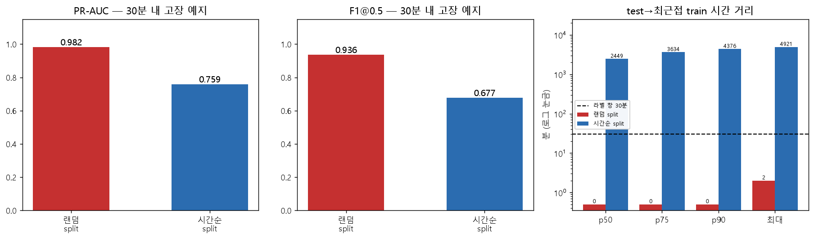

# 설비 예지보전 (Predictive Maintenance) — 센서 수집부터 대시보드까지

**CNC 밀링 설비의 센서 데이터를 수집·정제하고, 30분 내 고장을 예측합니다.**
데이터 수집(GitHub Actions 자동화), 정제, 학습, 평가, 대시보드 배포까지 전 구간을 구성했습니다.

**[대시보드 바로가기](https://predictive-maintenance-apxkzmfh789.streamlit.app)** · **[분석 리포트](reports/analysis_report.md)**

---

## 30초 요약

| 항목 | 내용 |
|---|---|
| **문제** | 설비 고장을 **사후 감지**가 아니라 **30분 전 예지** — 계획 정비로 라인 정지를 막는다 |
| **데이터** | ① 물리 기반 시뮬레이터(3대 × 14일, 55,591행) ② UCI AI4I 2020(10,000행) ③ UCI SECOM(1,567행 × 590센서) ④ GitHub Actions 매일 자동 수집 |
| **방법** | 수집(CSV + SQLite) → 정제 9단계 → 피처 100개 → RandomForest → **시간순 split** → **비용 기반 임계값** |
| **결과** | 시뮬레이터 **PR-AUC 0.761**(기준선 0.238) / AI4I **0.897**(기준선 0.034) / SECOM **0.083**(기준선 0.061, *실패*) |
| **핵심 발견** | 같은 데이터·모델을 랜덤 split으로 평가하면 PR-AUC가 **0.759 → 0.982로 부풀려집니다 (22.7% 과대평가)** |
| **한계** | 시뮬레이터는 합성 데이터, 비용은 가정값, SECOM은 예측 실패(원인 규명) |

모든 숫자는 `python run_all.py` 실행 결과이며, 근거는 [outputs/](outputs/)에 있습니다.

---

## 다룬 문제

제조 설비 데이터에는 일반 데이터에 없는 함정이 있습니다. 각 함정을 실측으로 확인했습니다.

| 함정 | 확인한 곳 |
|---|---|
| 현장 데이터 오염 (끊김, 중복, 단위 혼재, 드리프트) | [analysis/a1_pipeline.py](analysis/a1_pipeline.py) — 참값 대조로 정제 검증 |
| 극도 불균형 — 정확도가 무의미 | [analysis/a2_ai4i.py](analysis/a2_ai4i.py) |
| **시간 누수 (temporal leakage)** | [analysis/a3_leakage.py](analysis/a3_leakage.py) ← **핵심** |
| 센서 오작동 vs 진짜 이상 | [analysis/a4_outlier_trap.py](analysis/a4_outlier_trap.py) |
| 센서 드리프트 | [analysis/a5_drift.py](analysis/a5_drift.py) |
| 비용 비대칭과 임계값 | [analysis/a6_cost_threshold.py](analysis/a6_cost_threshold.py) |
| 고차원 저표본 · 다중검정 | [analysis/a7_secom.py](analysis/a7_secom.py) |
| 결측률이 숨기는 데이터 손실 | [analysis/a8_quality_metrics.py](analysis/a8_quality_metrics.py) |

---

## 핵심 결과

### 1. 정확도 96.6%짜리 쓸모없는 모델

AI4I 데이터의 고장률은 3.39%입니다. **"전부 정상"이라고만 답해도 정확도 96.6%** 이고, 재현율은 0입니다.

| 모델 | 정확도 | 재현율 | PR-AUC |
|---|---|---|---|
| 무조건 "정상" | **0.9660** | 0.0000 | 0.0340 |
| 랜덤포레스트 | 0.9824 | 0.5765 | 0.7889 |
| 랜덤포레스트 + 도메인 파생변수 | 0.9928 | 0.8235 | **0.8966** |

→ 정확도는 세 모델을 구분하지 못합니다. **PR-AUC를 기준선(= 고장률) 대비로 봐야 합니다.**

### 2. 시간 누수 — 랜덤 split이 만든 허수

같은 데이터, 같은 모델, 같은 하이퍼파라미터에서 **split 방식만** 바꿨습니다.

| split | ROC-AUC | PR-AUC | F1@0.5 |
|---|---|---|---|
| 랜덤 split (흔한 실수) | 0.9954 | **0.9819** | 0.9358 |
| 시간순 split (올바름) | 0.8956 | **0.7589** | 0.6771 |



**PR-AUC 22.7% 하락.** 원인은 자기상관입니다.
랜덤 split에서 test 행과 가장 가까운 train 행의 시간 거리는 **중앙값 0분**으로 바로 옆자리입니다.
예측 라벨이 "다음 30분"이라 인접 행의 라벨 창이 거의 통째로 겹칩니다.

> AI4I에서는 랜덤 split을 써도 거의 차이가 없습니다(lag-1 자기상관 0.005, 독립 스냅샷).
> "시계열이면 무조건 시간순 split"이 아니라 **"행 간 시간적 의존성이 있으면 시간순 split"** 이 정확한 원칙입니다.

### 3. 임계값 0.5는 근거 없는 관행

고장 놓침 800만원, 헛점검 30만원(가정)일 때 AI4I test 총비용:

| 임계값 | 재현율 | 정밀도 | 총비용 |
|---|---|---|---|
| 0.50 (관행) | 0.824 | 0.959 | 12,090만원 |
| 0.06 (test에서 고른 비용 최소) | 0.929 | 0.444 | 7,770만원 |
| **0.05 (교차검증으로 고른 비용 최소)** | 0.929 | 0.387 | **8,550만원** |

→ F1 최대 지점(0.435)과 비용 최소 지점은 다릅니다.
→ test에서 임계값을 고르면 절감률이 35.7%로 보이지만, 처음 보는 데이터 기준으로는 **29.3%** 입니다.
  test를 고르기와 평가에 같이 쓰면 **780만원만큼 낙관적**으로 추정됩니다.

### 4. 매일 자동 수집 · 재학습

| 구분 | 데이터 | 결과 | 갱신 |
|---|---|---|---|
| 2024년 기준 | 2024-01-01 ~ 01-14 고정 | `models/` | 고정 (재현용, 위 숫자) |
| 최근 14일 | 마지막 시각 기준 14일 | `models/recent/` | GitHub Actions가 매일 |

- GitHub Actions가 매일 06:17(KST)에 최근 24시간 데이터를 수집하고 재학습한 뒤 자동 커밋합니다
- 스케줄이 정시를 보장하지 않아 "특정 시각"이 아니라 "최근 24시간 구간"을 가져오고, (machine_id, ts) UNIQUE로 중복 실행에도 안전합니다
- 2024년 데이터와 수집 데이터 사이의 2년 공백이 섞이지 않도록 학습·품질 분석·대시보드가 같은 기간 기준을 씁니다
- 대시보드에서 기간을 선택해 두 기간의 데이터와 성능을 비교할 수 있습니다

---

## 프로젝트 구조

```
Predictive-Maintenance/
├── README.md
├── requirements.txt
├── run_all.py                 # 전체 재현 (학습 + 분석 a1~a8)
├── .github/workflows/
│   └── collect.yml            # 매일 자동 수집·재학습
├── src/
│   ├── simulator.py           # 물리 기반 센서 생성 + 현장급 오염 주입
│   ├── collector.py           # 최근 N분 수집 → CSV + SQLite
│   ├── db.py                  # SQLite 스키마 (UNIQUE로 중복 방어)
│   ├── build_db.py            # CSV → DB 재생성
│   ├── clean.py               # 9단계 정제 파이프라인
│   ├── features.py            # 예지 라벨 + 파생변수 + 롤링 (과거만 참조)
│   ├── train.py               # 시간순 split 학습 + 비용 기반 임계값 (--recent 옵션)
│   └── download_data.py       # UCI 데이터 다운로드
├── analysis/                  # a1~a8 분석 스크립트 (각각 독립 실행 가능)
├── app/streamlit_app.py       # 대시보드
├── data/
│   ├── history/               # 일별 수집 CSV (원본, git에 커밋)
│   └── raw/                   # UCI 원본 (gitignore, 스크립트로 재현)
├── models/                    # 2024년 기준 결과 (recent/ = 최근 14일)
├── outputs/                   # run_all 실행 로그 (숫자의 근거)
└── reports/
    ├── analysis_report.md     # 분석 리포트
    └── figures/
```

---

## 실행 방법

Python 3.12 이상이 필요합니다 (`requirements.txt`의 scipy 버전 기준, 3.13에서 확인).

```bash
git clone https://github.com/apxkzmfh789/Predictive-Maintenance
cd Predictive-Maintenance
pip install -r requirements.txt

python run_all.py                         # 전체 재현 (5~10분), 결과는 outputs/
streamlit run app/streamlit_app.py        # 대시보드 (로컬)
```

단계별로 실행할 때:

```bash
python src/download_data.py               # UCI 데이터 받기
python src/build_db.py                    # CSV → SQLite
python src/train.py                       # 2024년 기준 학습 → models/
python src/train.py --recent 14           # 최근 14일 학습 → models/recent/

cd analysis
python a1_pipeline.py                     # a3는 a1이 만든 정제 데이터를 사용
python a2_ai4i.py                         # 이후 a3 ~ a8 순서대로
```

센서 수집(`src/collector.py`)은 GitHub Actions가 매일 실행합니다.
GitHub Actions(공개 저장소)와 Streamlit Community Cloud 모두 무료로 운영됩니다.

---

## 데이터

| 출처 | 규모 | 라이선스/비고 |
|---|---|---|
| 자체 시뮬레이터 | 3대 × 14일 × 1분 = 55,591행(오염 후) | **합성 데이터**, 고장 규칙은 AI4I 정의를 따름 |
| GitHub Actions 수집 | 하루 약 3,900행 (2026-10-22부터) | 같은 시뮬레이터로 매일 최근 24시간 생성 |
| [UCI AI4I 2020](https://archive.ics.uci.edu/dataset/601/) | 10,000행 × 14열, 고장률 3.39% | CC BY 4.0 |
| [UCI SECOM](https://archive.ics.uci.edu/dataset/179/) | 1,567행 × 590센서, 불량률 6.64% | CC BY 4.0 |

---

## 한계와 가정

- **시뮬레이터 데이터는 합성입니다.** 성능 수치를 실제 설비에 그대로 적용할 수 없습니다.
  이 프로젝트의 결과물은 성능이 아니라 **파이프라인 설계와 검증 방법**입니다.
- **시뮬레이터의 고장 규칙은 결정론적**이라 실제 설비보다 예측이 쉽습니다.
  그래서 실데이터(AI4I·SECOM)를 함께 분석했습니다.
- **비용 가정(800만원 : 30만원)은 추정치입니다.** 실제로는 정비팀에서 받아야 하며, 비용비가 바뀌면 최적 임계값도 바뀝니다(민감도 분석 포함).
- **SECOM은 예측에 실패했습니다**(PR-AUC 0.083, 기준선 0.061).
  실패 원인(효과크기 0.32, 불량 104건, 공정 분포 이동 92%)을 규명했고, 학습 곡선으로 데이터를 늘려도 개선되지 않음을 확인했습니다.
- **AI4I 라벨에 모순이 있습니다.** RNF 19건 중 18건이 `Machine failure=0`입니다. 원본 정의를 그대로 두고 분석했습니다.
- 시뮬레이터 모델(`train.py`)은 아직 test에서 임계값을 고릅니다. AI4I에서 확인한 것과 같은 낙관 편향이 남아 있습니다.
- "30분 내 고장" 라벨은 빈 행을 제외한 뒤 만들어 실제로는 "다음 30행"입니다. 통신 공백을 사이에 두면 30분보다 긴 구간이 됩니다.
- 대시보드의 손실률 8.08%는 흔들린 타임스탬프를 정리하기 전 값입니다. 정제 기준 실제 손실은 10.9%입니다.
- 14일치 데이터라 **계절성·장기 열화**를 반영하지 못합니다.
- 상관은 인과가 아닙니다. "토크를 낮추면 고장이 준다"고 말할 수 없습니다.

전체 한계는 [분석 리포트 5장](reports/analysis_report.md#5-한계와-가정)에 정리했습니다.

---

## 무엇을 배웠나

1. **정확도를 쓰지 않는 법.** 불균형 데이터에서는 PR-AUC를 기준선 대비로 봅니다.
2. **누수는 데이터가 아니라 문제 정의에서 생깁니다.** 같은 데이터라도 '감지'로 풀면 누수가 없고, '예지'로 풀면 22.7%가 부풀려집니다.
3. **평가 방법도 검증 대상입니다.** 임계값을 test로 고르면 성능이 낙관적으로 보입니다. 교차검증으로 그 차이(780만원)를 직접 측정했습니다.
4. **안 되는 걸 안 된다고 쓰는 것.** SECOM에서 성능을 내지 못했고, 데이터를 바꿔 좋아 보이게 만드는 대신 그 이유를 규명했습니다.