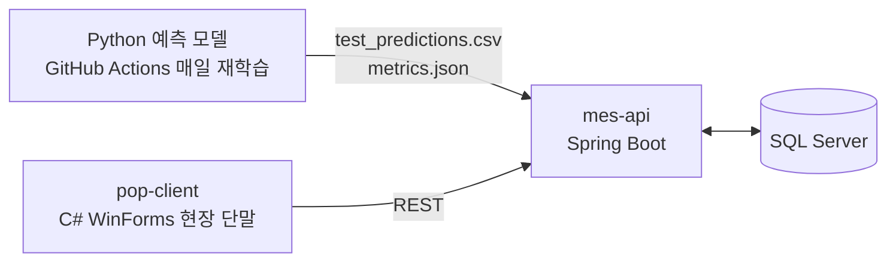

# mes-api — 예지보전 경보·보전 작업지시 MES API

설비 고장 예측 결과를 받아 **경보 → 현장 확인 → 보전 작업지시 → 조치 완료 → 이력·집계**까지 처리하는 MES 백엔드입니다.
같은 저장소의 Python 예측 모델(30분 내 고장 확률)이 만든 결과를 현장 업무로 연결합니다.

## 30초 요약

| 항목 | 내용 |
|---|---|
| 하는 일 | 예측 파일 적재 → 경보 자동 판정 → 경보 확인·오경보 종료 → 작업지시 생성·시작·완료·취소 → 이력·집계 |
| 기술 | Java 21, Spring Boot 4.0, MyBatis, SQL Server 2025, JUnit 5 |
| 규모 | REST API 18개, 테이블 6개, 업무 규칙 R1~R18, 설계 결정 D1~D23 |
| 핵심 | 경보 폭주 방지 판정 규칙, 조건부 UPDATE로 동시 처리 방지, 여러 테이블 상태를 한 트랜잭션으로 변경 |

## 전체 구성



## 업무 흐름

```
경보:     OPEN ──→ ACK ───────────────────────────────────── CLOSED (RESOLVED)
                    │                                              ↑
                    ├──→ CLOSED (FALSE_ALARM, 메모 필수)            │
                    │                                              │
작업지시:            └──→ WAITING ──→ IN_PROGRESS ──→ DONE ─────────┘
                           │
                           └──→ CANCELED (시작 전만)

설비:     RUNNING ───────────────→ MAINTENANCE ──────────→ RUNNING
                               (작업 시작)            (작업 완료)
```

- 작업지시 완료 한 번에 **작업지시·경보·설비 3개 테이블**이 같이 바뀝니다
- 모든 상태 변경은 `status_history`에 대상·이전·이후 상태·변경자·메모로 남습니다

## 핵심 설계

### 1. 경보 폭주를 막는 판정 규칙 (R5~R7)

1분 단위 예측에 임계값만 적용하면 경보가 매분 쌓입니다. 세 가지 규칙으로 막았습니다.

| 규칙 | 내용 |
|---|---|
| 연속 2회 (R5) | 한 번 튀는 값은 무시. 데이터가 2분 넘게 끊기면 연속 횟수 초기화 |
| 열린 경보 갱신 (R6) | 같은 설비에 처리 중인 경보가 있으면 새로 만들지 않고 최고 확률·감지 횟수만 갱신 |
| 재발생 금지 30분 (R7) | 경보 종료 후 30분은 같은 원인으로 보고 새 경보를 만들지 않음 |

판정 로직은 DB 없이 동작하는 `AlarmJudge`로 분리했고, 설계 문서의 예시 상황 5개를 단위 테스트로 검증했습니다.

### 2. 운영 임계값을 데이터로 정함 (D23)

모델 임계값(매일 0.01~0.2)을 그대로 쓰면 설비당 하루 22건, 진짜 경보는 26%입니다.
판정 규칙을 그대로 재현한 [점검 스크립트](docs/threshold_check.py)로 임계값별 경보 부담을 비교해 **0.3**으로 고정했습니다.

| 임계값 | 설비당 하루 경보 | 진짜 경보 | 고장 포착 |
|---|---|---|---|
| 0.01 (모델) | 22.0 | 26% | 75% |
| **0.30 (적용)** | **9.9** | **51%** | **67%** |
| 0.50 | 6.8 | 63% | 55% |

### 3. 조건부 UPDATE로 동시 처리 방지 (R17)

두 작업자가 같은 경보를 동시에 확인해도 한 명만 성공합니다.

```sql
UPDATE alarm SET status = 'ACK', acked_at = SYSDATETIME(), acked_by = #{ackedBy}
WHERE alarm_id = #{alarmId} AND status = 'OPEN'   -- 바뀐 행이 0이면 409
```

- 상태 검사와 변경을 한 문장으로 처리해 그 사이에 끼어들 틈이 없습니다
- 0건이면 다시 조회해 원인을 구분합니다: 대상 없음 404, 상태 불일치 409
- 작업지시 생성은 `INSERT ... SELECT ... WHERE`로 같은 원리를 쓰고, 동시에 둘 다 통과하는 경우는 필터 고유 인덱스(`UX_work_order_active`)가 마지막으로 막습니다

### 4. 여러 테이블을 한 트랜잭션으로

작업지시 완료 시 작업지시 DONE, 경보 CLOSED(RESOLVED), 설비 RUNNING을 한 `@Transactional` 안에서 처리합니다.
설비·경보 상태 변경은 각 패키지의 Service(`EquipmentService.changeStatus`, `AlarmService.resolve`)만 할 수 있고 API로는 노출하지 않습니다.

### 5. 데이터 시각과 처리 시각을 분리 (D12)

예측은 파일로 나중에 들어오기 때문에 두 시각이 다릅니다.

| 시각 | 쓰는 곳 |
|---|---|
| 데이터 시각 (센서 측정 시각) | 경보 판정, 재발생 금지 기준 |
| 처리 시각 (확인·완료 등을 기록한 시각) | 집계 지표 |

## API

| 구분 | 메서드·주소 | 기능 |
|---|---|---|
| 설비 | `GET /api/equipments` | 목록 |
| | `GET /api/equipments/{id}` | 상세 |
| | `POST /api/equipments` | 등록 |
| | `PUT /api/equipments/{id}` | 이름·위치·사용 여부 수정 |
| 예측 | `POST /api/predictions/import` | 예측 CSV·metrics.json 업로드, 경보 판정까지 실행 |
| | `GET /api/predictions?equipmentId=&from=&to=` | 기간별 예측 |
| 경보 | `GET /api/alarms?status=&equipmentId=` | 목록 |
| | `GET /api/alarms/{id}` | 상세 |
| | `PATCH /api/alarms/{id}/ack` | 확인 |
| | `PATCH /api/alarms/{id}/close` | 오경보 종료 |
| 작업지시 | `POST /api/alarms/{id}/work-orders` | 경보에서 생성 |
| | `GET /api/work-orders?status=&equipmentId=` | 목록 |
| | `PATCH /api/work-orders/{id}/start` | 시작 |
| | `PATCH /api/work-orders/{id}/complete` | 완료 |
| | `PATCH /api/work-orders/{id}/cancel` | 취소 |
| 이력·집계 | `GET /api/history?targetType=&targetId=` | 상태 변경 이력 |
| | `GET /api/stats/equipments?from=&to=` | 설비별 지표 |
| | `GET /api/stats/daily?from=&to=` | 일별 건수 |

에러는 모두 같은 형식입니다.

```json
{"code": "ALARM_STATUS_CONFLICT", "message": "현재 경보 상태에서는 처리할 수 없습니다: alarmId 1, 현재 상태 CLOSED"}
```

## 패키지 구조

```
io.github.apxkzmfh789.mes
├── common       에러 코드, 공통 예외 처리
├── equipment    설비 기준정보, 설비 상태 변경
├── prediction   예측 파일 읽기·적재
├── alarm        경보 판정(AlarmJudge), 확인·종료
├── workorder    작업지시 생성·시작·완료·취소
├── history      상태 변경 이력
└── stats        설비별·일별 집계
```

기능별로 Controller → Service → Mapper(MyBatis XML)를 한 패키지에 묶었습니다.

## 실행 방법

1. SSMS에서 sa로 [db/setup.sql](db/setup.sql) 실행 — DB와 앱 계정(`mes_app`, 읽기·쓰기만) 생성. `<비밀번호>`는 직접 지정
2. sa로 [db/schema.sql](db/schema.sql), [db/data.sql](db/data.sql) 순서로 실행 — 테이블 6개, 설비 3대
3. 환경변수 `MES_DB_PASSWORD`에 1번 비밀번호 설정
4. 실행 (Windows cmd 기준, PowerShell은 `.\gradlew`)

   ```
   cd mes-api
   gradlew bootRun
   ```

5. 판정 로직 단위 테스트

   ```
   gradlew test --tests "*AlarmJudgeTest"
   ```

## 시연 순서

1. `POST /api/predictions/import` — form-data로 `predictions`(models/recent/test_predictions.csv), `metrics`(models/recent/metrics.json), `importedBy`, `from`, `to`(1시간 구간)
2. `GET /api/alarms?status=OPEN&status=ACK` — 생성된 경보 확인
3. `PATCH /api/alarms/{id}/ack` — 확인
4. `POST /api/alarms/{id}/work-orders` — 작업지시
5. `PATCH /api/work-orders/{id}/start` — 설비가 MAINTENANCE로 바뀜
6. `PATCH /api/work-orders/{id}/complete` — 경보 CLOSED, 설비 RUNNING
7. `GET /api/history?targetType=ALARM&targetId={id}`, `GET /api/stats/equipments?from=&to=`

예측 파일은 매일 최근 데이터로 바뀌므로 `from`·`to`는 파일 안의 기간으로 지정합니다 (CSV는 UTC, 적재 시 KST로 변환).

## 문서

- [업무 설계](docs/01_business_design.md) — 업무 규칙 R1~R18, 설계 결정, 검증 결과, 한계
- [DB 설계](docs/02_db_design.md) — 테이블, 제약조건, 인덱스
- [ERD](docs/erd.png)

## 한계

- 실시간 수신이 아니라 파일 적재 방식. 1시간 구간 적재로 실시간을 흉내 냄
- 학습 데이터가 시뮬레이터라 실제 설비와 다를 수 있고, 임계값 0.3은 가정 기반이라 현장 결과 코드(NO_ISSUE 비율)로 다시 조정해야 함
- 로그인·권한이 없어 처리자는 이름으로만 기록
