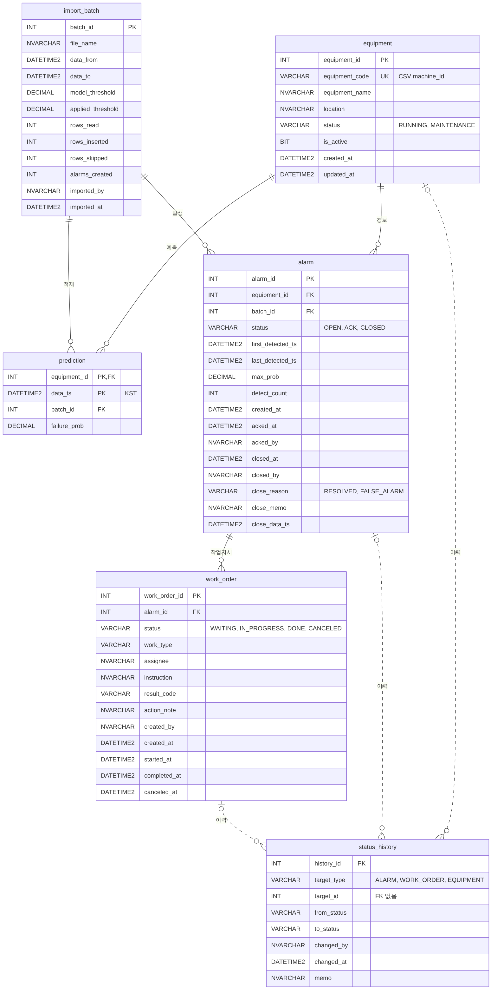
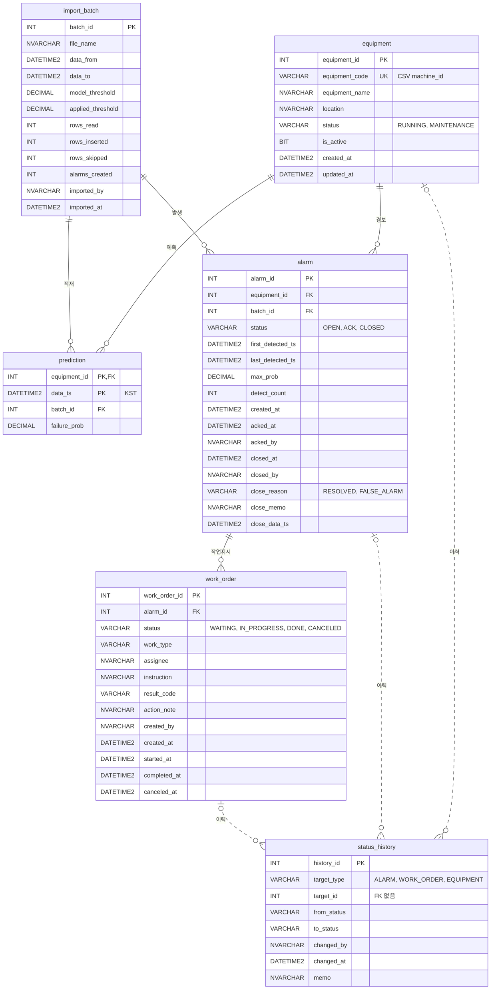

# 2단계 DB 설계 — 예지보전 경보·보전 작업지시

> 작성일: 2026-10-26 · 수정일: 2026-10-27 · 작성자: 이창우
> 대상: `mes-api` (SQL Server 2025) · 업무 규칙(R1~R18)과 결정 D1~D13, D19~D22는 [01_business_design.md](01_business_design.md)

## 1. 공통 규칙

### 1.1 시각

- 모든 시각은 KST (D11). 예측 CSV의 `ts`(UTC)는 적재할 때 +9시간
- 처리 시각(생성·확인·종료 등)은 DB의 `SYSDATETIME()`으로 기록해 서버 하나의 시계로 통일

### 1.2 데이터 타입

| 대상 | 타입 | 이유 |
|---|---|---|
| ID | `INT IDENTITY` | 테이블별 연간 행 수가 INT 범위보다 훨씬 작음 |
| 시각 | `DATETIME2(0)` | 초 단위면 충분, 6바이트. `DATETIME`은 정밀도 3.33ms 단위, 8바이트 |
| 상태·코드 | `VARCHAR(20)` | 영문 코드라 유니코드 불필요 |
| 이름·메모 | `NVARCHAR` | 한글 저장 |
| 확률·임계값 | `DECIMAL(7,6)` | `≥ 임계값` 비교가 정확, `FLOAT`(8바이트)보다 작은 5바이트 |

### 1.3 제약조건 이름

| 종류 | 형식 | 예 |
|---|---|---|
| PK | `PK_테이블` | `PK_alarm` |
| FK | `FK_자식_부모` | `FK_alarm_equipment` |
| UNIQUE 제약 | `UQ_테이블_컬럼` | `UQ_equipment_code` |
| 필터 UNIQUE 인덱스 | `UX_테이블_내용` | `UX_alarm_open` |
| 일반 인덱스 | `IX_테이블_컬럼` | `IX_alarm_created` |
| CHECK | `CK_테이블_내용` | `CK_alarm_status` |
| DEFAULT | `DF_테이블_컬럼` | `DF_alarm_created_at` |

- 이름을 지정하지 않으면 `PK__equipmen__3213E83F...` 같은 이름이 붙어 에러 메시지로 원인을 찾기 어려움

## 2. 테이블 목록

| # | 테이블 | 한글 이름 | 역할 | 쌓이는 양 |
|---|---|---|---|---|
| 1 | `equipment` | 설비 | 설비 기준정보와 현재 상태 | 3행 |
| 2 | `import_batch` | 적재 이력 | 예측 파일 적재 시각, 적용 임계값, 건수 | 하루 1행 |
| 3 | `prediction` | 예측 결과 | 설비·시각별 고장 확률 | 하루 약 4,300행, 1년 약 150만 행 |
| 4 | `alarm` | 경보 | 경보 상태, 최고 확률, 감지 횟수, 종료 사유 | 1년 수만 행 이하 |
| 5 | `work_order` | 보전 작업지시 | 담당자, 작업 유형, 결과 코드, 조치 내용 | 경보보다 적음 |
| 6 | `status_history` | 상태 변경 이력 | 경보·작업지시·설비의 모든 상태 변경 | 1년 약 10만 행 |

### 관계

```
equipment ─┬─< prediction >─ import_batch
           ├─< alarm ──────< work_order
           │      └──────── import_batch (어느 적재에서 생겼는지)
status_history : 경보·작업지시·설비 어느 것이든 기록 (대상 종류 + 대상 ID)
```

### 만들지 않은 테이블

| 후보 | 이유 |
|---|---|
| 공통코드 | 상태값이 상태 전이 로직과 묶여 있어 사용자가 바꾸면 안 됨 → CHECK 제약으로 허용 값 제한 |
| 작업자 | 담당자는 이름 문자열로 저장 (D3) |
| 설비 상태 이력 | `status_history`에 같이 기록 (D15) |
| 설정값 | `application.yml`에 둠 (D13) |

## 3. 컬럼

### 3.1 `equipment` 설비

| 컬럼 | 타입 | NULL | 설명 |
|---|---|---|---|
| equipment_id | INT IDENTITY | X | PK |
| equipment_code | VARCHAR(20) | X | 설비 코드, CSV의 `machine_id`와 매칭, 변경 불가 (R14) |
| equipment_name | NVARCHAR(50) | X | 예: CNC 밀링 1호기 |
| location | NVARCHAR(50) | O | 설치 위치·라인 |
| status | VARCHAR(20) | X | RUNNING / MAINTENANCE |
| is_active | BIT | X | 사용 여부 (R3) |
| created_at | DATETIME2(0) | X | 등록 시각 |
| updated_at | DATETIME2(0) | X | 마지막 수정 시각 |

- 예측·경보가 설비를 참조해 삭제할 수 없으므로 삭제 대신 `is_active = 0`으로 처리

### 3.2 `import_batch` 적재 이력

| 컬럼 | 타입 | NULL | 설명 |
|---|---|---|---|
| batch_id | INT IDENTITY | X | PK |
| file_name | NVARCHAR(260) | X | 적재한 파일 이름 |
| data_from | DATETIME2(0) | O | 파일 안 데이터 시각의 시작 |
| data_to | DATETIME2(0) | O | 파일 안 데이터 시각의 끝 |
| model_threshold | DECIMAL(7,6) | X | `metrics.json`의 임계값 |
| applied_threshold | DECIMAL(7,6) | X | 실제 적용한 임계값 (R1) |
| rows_read | INT | X | 읽은 행 |
| rows_inserted | INT | X | 저장한 행 |
| rows_skipped | INT | X | 건너뛴 행 전체 (중복 R2 + 사용 안 하는 설비 R3) |
| alarms_created | INT | X | 새로 생긴 경보 수 |
| imported_by | NVARCHAR(50) | X | 적재한 사람 |
| imported_at | DATETIME2(0) | X | 적재 시각 |

### 3.3 `prediction` 예측 결과

| 컬럼 | 타입 | NULL | 설명 |
|---|---|---|---|
| equipment_id | INT | X | PK, FK 설비 |
| data_ts | DATETIME2(0) | X | PK, 데이터 시각 (KST) |
| batch_id | INT | X | FK 적재 이력 |
| failure_prob | DECIMAL(7,6) | X | 30분 내 고장 확률 |

- PK는 `(equipment_id, data_ts)` (D16)
- CSV의 `y`(정답)는 저장하지 않음. 운영 중에는 예측 시점에 정답을 알 수 없고, 정답 비교 검증은 Python에서 완료
- `created_at` 없음. 적재 시각은 `batch_id`로 확인
- 1년치 약 60MB (인덱스 제외)

### 3.4 `alarm` 경보

| 컬럼 | 타입 | NULL | 설명 |
|---|---|---|---|
| alarm_id | INT IDENTITY | X | PK |
| equipment_id | INT | X | FK 설비 |
| batch_id | INT | X | FK 경보를 발생시킨 적재, 적용 임계값 추적용 (D14) |
| status | VARCHAR(20) | X | OPEN / ACK / CLOSED |
| first_detected_ts | DATETIME2(0) | X | 발생 조건(연속 횟수)을 채운 데이터 시각 |
| last_detected_ts | DATETIME2(0) | X | 마지막으로 임계값을 넘은 데이터 시각 (R6 갱신) |
| max_prob | DECIMAL(7,6) | X | 최고 확률 (R6 갱신) |
| detect_count | INT | X | 임계값을 넘은 횟수. 발생 조건을 채운 횟수부터 포함 (기본 설정이면 생성 시 2), R6 갱신 |
| created_at | DATETIME2(0) | X | 경보 생성 시각 |
| acked_at | DATETIME2(0) | O | 확인 시각 |
| acked_by | NVARCHAR(50) | O | 확인한 사람 |
| closed_at | DATETIME2(0) | O | 종료 시각 |
| closed_by | NVARCHAR(50) | O | 종료한 사람 (자동 종료면 작업 완료자) |
| close_reason | VARCHAR(20) | O | RESOLVED / FALSE_ALARM |
| close_memo | NVARCHAR(500) | O | 오경보 메모 (R9) |
| close_data_ts | DATETIME2(0) | O | 종료 시점에 그 설비의 마지막 데이터 시각, 재발생 금지 계산용 (R7) |

- `acked_by`, `closed_by`는 이력과 중복되지만 목록·집계에서 매번 이력을 조인하지 않기 위해 둠

### 3.5 `work_order` 보전 작업지시

| 컬럼 | 타입 | NULL | 설명 |
|---|---|---|---|
| work_order_id | INT IDENTITY | X | PK |
| alarm_id | INT | X | FK 경보 |
| status | VARCHAR(20) | X | WAITING / IN_PROGRESS / DONE / CANCELED |
| work_type | VARCHAR(20) | X | INSPECTION / REPAIR / REPLACE |
| assignee | NVARCHAR(50) | X | 담당자 |
| instruction | NVARCHAR(500) | O | 지시 내용 |
| result_code | VARCHAR(20) | O | NO_ISSUE / ADJUSTED / PART_REPLACED / REPAIRED |
| action_note | NVARCHAR(1000) | O | 조치 내용 |
| created_by | NVARCHAR(50) | X | 지시한 사람 |
| created_at | DATETIME2(0) | X | 생성 시각 |
| started_at | DATETIME2(0) | O | 시작 시각 |
| completed_at | DATETIME2(0) | O | 완료 시각 |
| canceled_at | DATETIME2(0) | O | 취소 시각 |

- `equipment_id`는 두지 않음. 경보를 조인하면 알 수 있고, 두 곳에 두면 값이 어긋날 위험이 있음
- 취소 사유는 `status_history.memo`에 기록

### 3.6 `status_history` 상태 변경 이력

| 컬럼 | 타입 | NULL | 설명 |
|---|---|---|---|
| history_id | INT IDENTITY | X | PK |
| target_type | VARCHAR(20) | X | ALARM / WORK_ORDER / EQUIPMENT |
| target_id | INT | X | 대상 ID (FK 없음) |
| from_status | VARCHAR(20) | O | 이전 상태, 처음 생성될 때는 NULL |
| to_status | VARCHAR(20) | X | 이후 상태 |
| changed_by | NVARCHAR(50) | X | 바꾼 사람, 시스템이면 SYSTEM |
| changed_at | DATETIME2(0) | X | 변경 시각 |
| memo | NVARCHAR(500) | O | 메모 |

- 경보·작업지시·설비 ID를 모두 INT로 맞춰 `target_id` 하나에 담음

## 4. 제약조건

### 4.1 PK

| 테이블 | PK |
|---|---|
| equipment | equipment_id |
| import_batch | batch_id |
| prediction | (equipment_id, data_ts) |
| alarm | alarm_id |
| work_order | work_order_id |
| status_history | history_id |

### 4.2 FK

| 이름 | 자식 → 부모 |
|---|---|
| FK_prediction_equipment | prediction.equipment_id → equipment |
| FK_prediction_batch | prediction.batch_id → import_batch |
| FK_alarm_equipment | alarm.equipment_id → equipment |
| FK_alarm_batch | alarm.batch_id → import_batch |
| FK_work_order_alarm | work_order.alarm_id → alarm |

- 삭제 동작은 모두 `NO ACTION` (부모 삭제 거부). 이력이 남아야 하는 시스템이라 `CASCADE`는 쓰지 않음
- `status_history`는 FK 없음 (D15)

### 4.3 UNIQUE

| 이름 | 대상 | 규칙 |
|---|---|---|
| UQ_equipment_code | equipment(equipment_code) | 설비 코드 중복 금지 |
| UX_alarm_open | alarm(equipment_id) WHERE status IN ('OPEN','ACK') | R6 설비당 열린 경보 1개 |
| UX_work_order_active | work_order(alarm_id) WHERE status IN ('WAITING','IN_PROGRESS') | R10 경보당 진행 중 작업지시 1개 |

- R2(예측 중복 금지)는 `PK_prediction`이 보장
- `import_batch.file_name`은 UNIQUE 아님. 같은 파일 재적재는 허용하고 중복 행은 R2로 건너뜀
- 필터 UNIQUE 인덱스는 조건에 맞는 행끼리만 중복을 막음 (D17)

### 4.4 CHECK — 값 범위

| 테이블 | 조건 |
|---|---|
| equipment | `status IN ('RUNNING','MAINTENANCE')` |
| import_batch | 임계값 2개 `BETWEEN 0 AND 1`, 건수 모두 `>= 0`, `rows_inserted + rows_skipped = rows_read`, `data_from <= data_to` |
| prediction | `failure_prob BETWEEN 0 AND 1` |
| alarm | `status IN ('OPEN','ACK','CLOSED')`, `close_reason IN ('RESOLVED','FALSE_ALARM')`, `max_prob BETWEEN 0 AND 1`, `detect_count >= 1`, `first_detected_ts <= last_detected_ts` |
| work_order | `status IN ('WAITING','IN_PROGRESS','DONE','CANCELED')`, `work_type IN ('INSPECTION','REPAIR','REPLACE')`, `result_code IN ('NO_ISSUE','ADJUSTED','PART_REPLACED','REPAIRED')` |
| status_history | `target_type IN ('ALARM','WORK_ORDER','EQUIPMENT')` |

### 4.5 CHECK — 상태와 컬럼의 일치 (D18)

| 테이블 | 상태 | 조건 |
|---|---|---|
| alarm | OPEN | 확인·종료 컬럼 모두 NULL |
| | ACK | `acked_at`, `acked_by` 있음, 종료 컬럼 모두 NULL |
| | CLOSED | 확인 컬럼과 `closed_at`, `closed_by`, `close_reason`, `close_data_ts` 모두 있음 |
| | 오경보 | `close_reason = 'FALSE_ALARM'`이면 `close_memo` 있음 (R9) |
| work_order | WAITING | 시작·완료·취소 시각 모두 NULL |
| | IN_PROGRESS | `started_at`만 있음 |
| | DONE | `started_at`, `completed_at`, `result_code`, `action_note` 있음, `canceled_at` NULL (R11) |
| | CANCELED | `canceled_at`만 있음 (R12) |

- 결과적으로 DB가 함께 막는 규칙
  - CLOSED에 확인 시각이 필수 → 확인 없이 종료 불가 (R8)
  - CANCELED에 시작 시각이 없어야 함 → 대기 상태에서만 취소 가능 (R12)
  - DONE에 결과 코드·조치 내용 필수 (R11)

### 4.6 DEFAULT

| 컬럼 | 기본값 |
|---|---|
| 모든 `created_at`, `imported_at`, `changed_at`, equipment의 `updated_at` | `SYSDATETIME()` |
| equipment.status / alarm.status / work_order.status | `'RUNNING'` / `'OPEN'` / `'WAITING'` |
| equipment.is_active | `1` |

### 4.7 DB가 막지 못해 서비스 코드가 막는 규칙

| 규칙 | 이유 |
|---|---|
| R9 진행 중 작업지시가 있으면 오경보 종료 거부 | 다른 테이블의 상태를 봐야 해서 CHECK로 불가능 |
| R10 작업지시는 ACK 경보에서만 생성 | 같은 이유 |
| R5 연속 횟수, R7 재발생 금지 | 여러 행을 시간순으로 비교해야 함 |
| 상태 전이 순서 (예: DONE → WAITING 금지) | CHECK는 바뀐 뒤의 행만 볼 수 있음 → R17 조건부 UPDATE로 막음 |
| `status_history.target_id`의 실제 존재 여부 | FK 없음 (D15) |

- 1차 검증은 서비스 코드, 4.4·4.5의 CHECK는 코드 버그로 잘못된 데이터가 저장되는 것을 막는 2차 방어선

## 5. 인덱스

### 5.1 원칙

- 실행할 쿼리를 먼저 정하고 그 쿼리에 필요한 인덱스만 만듦
- 인덱스가 의미 있는 규모는 `prediction`(1년 약 150만 행)뿐이고, 나머지는 수만 행 이하
- SQL Server는 FK에 인덱스를 자동으로 만들지 않음 → 쿼리를 보고 판단

### 5.2 목록

| 테이블 | 인덱스 | 컬럼 | 쓰는 쿼리 |
|---|---|---|---|
| equipment | UQ_equipment_code | equipment_code | 적재 시 CSV 설비 코드로 설비 찾기 |
| prediction | PK_prediction (클러스터드) | equipment_id, data_ts | 경보 판정, 기간 조회, 설비의 마지막 데이터 시각 |
| alarm | UX_alarm_open (필터) | equipment_id WHERE OPEN·ACK | 적재 시 설비의 열린 경보 찾기 (R6) |
| | IX_alarm_equipment_created | equipment_id, created_at | 설비별 경보 목록, 설비의 마지막 종료 경보 (R7) |
| | IX_alarm_created | created_at | 경보 목록 최신순, 기간별 집계 |
| work_order | UX_work_order_active (필터) | alarm_id WHERE WAITING·IN_PROGRESS | 경보의 진행 중 작업지시 (R9, R10) |
| | IX_work_order_alarm | alarm_id | 경보 상세에서 작업지시 전체 조회 |
| status_history | IX_history_target | target_type, target_id, changed_at | 대상별 이력 시간순 조회 |

### 5.3 만들지 않은 인덱스

| 후보 | 이유 |
|---|---|
| prediction.batch_id | 적재 단위로 예측을 찾는 쿼리가 없음, 대용량 테이블의 적재 속도 저하 |
| alarm.status, work_order.status | 행이 적고 값이 3~4가지뿐이라 이득이 거의 없음 |
| alarm.batch_id | 경보 → 적재 방향 조회만 있음 (import_batch PK로 해결) |

### 5.4 구현 시 주의

- 예측 적재는 없는 행만 넣음 (`INSERT ... WHERE NOT EXISTS`). 그냥 INSERT하면 중복 행에서 PK 위반으로 적재 전체가 실패
- 최근 14일 모델은 매일 다시 학습해 파일끼리 기간이 겹칠 수 있음 → R2대로 먼저 들어온 값 유지. 그 시점에 실제로 본 예측이기 때문
- 필터 인덱스를 쓰는 쿼리는 상태값을 파라미터(`#{status}`)가 아닌 값으로 직접 작성 (`status IN ('OPEN','ACK')`). 파라미터로 쓰면 실행 계획이 필터 인덱스를 쓰지 못할 수 있음
- 필터 인덱스가 있는 테이블의 INSERT·UPDATE는 `QUOTED_IDENTIFIER ON` 필요 (JDBC 드라이버·SSMS 기본값 ON)
- `updated_at`의 DEFAULT는 INSERT에만 적용 → UPDATE 쿼리에서 `SYSDATETIME()`을 직접 넣음
- 설비당 열린 경보가 1개뿐이라(R6) 경보는 순서대로 생기고 닫힘 → 마지막 종료 경보는 `equipment_id` + `created_at` 역순 첫 행으로 조회
- 3단계에서 SSMS 실제 실행 계획(Ctrl+M)으로 각 쿼리가 의도한 인덱스를 쓰는지 확인

## 6. ERD





### 범례

| 표기 | 뜻 |
|---|---|
| 실선 `\|\|--o{` | 1 : 0개 이상, FK 있음 |
| 점선 `\|o..o{` | 0 또는 1 : 0개 이상, FK 없이 `target_type + target_id`로 참조 |

- Mermaid는 타입에 쉼표를 쓸 수 없어 길이(`DECIMAL(7,6)` 등)는 생략, 기준은 3장
- CHECK, 필터 UNIQUE, 인덱스는 그림에 없음, 기준은 4·5장
- 기준은 이 Mermaid 코드, `erd.png`는 GitHub 밖(포트폴리오 PDF 등)용 내보내기. 스키마 변경 시 코드를 먼저 고치고 PNG를 다시 생성

## 7. 설계 결정 기록

| 번호 | 결정 | 이유 |
|---|---|---|
| D14 | 적재 이력 `import_batch` 테이블 추가 | 적재마다 임계값이 바뀔 수 있어(R1) 경보별 적용 임계값 추적에 필요. MES 인터페이스 이력(받은 건수, 건너뛴 건수) 관행 |
| D15 | 상태 변경 이력은 `status_history` 테이블 하나 | 전체 이력을 시간순으로 한 번에 조회. 대상 ID에 FK를 걸 수 없어 서비스 코드에서 검증 |
| D16 | `prediction`의 PK를 `(equipment_id, data_ts)` 클러스터드로 하고 대리키 없음 | 모든 조회가 설비 + 시간 범위이고 행 하나를 ID로 참조하는 곳이 없음. 인덱스 1개로 중복 방지(R2)와 범위 조회를 함께 해결 |
| D17 | R6, R10을 필터 UNIQUE 인덱스로 DB에서도 보장 | 요청이 동시에 들어오면 서비스 코드 검사만으로는 열린 경보나 진행 중 작업지시가 2개 생길 수 있음 |
| D18 | 상태와 컬럼의 일치를 CHECK로 검사 | 코드 버그로 잘못된 상태 데이터가 저장되는 것을 막는 2차 방어선 |

## 8. 한계

- 적재가 실패하면 트랜잭션 전체가 롤백되어 실패 이력은 DB에 남지 않고 서버 로그에만 남음
- `status_history.target_id`는 FK가 없어 DB 차원의 참조 무결성이 없음
