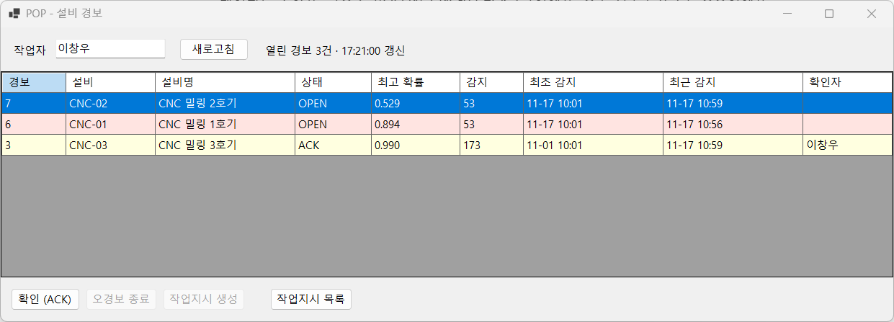
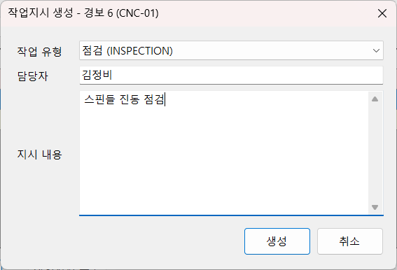
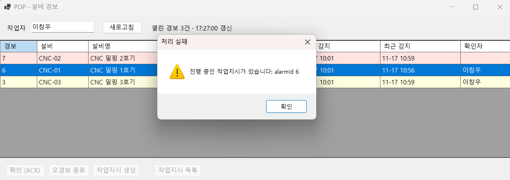
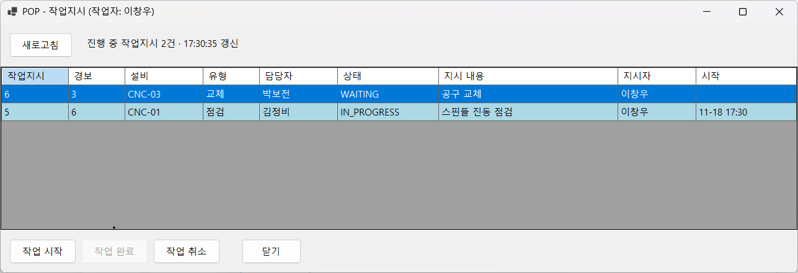
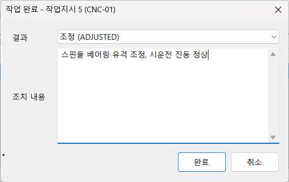
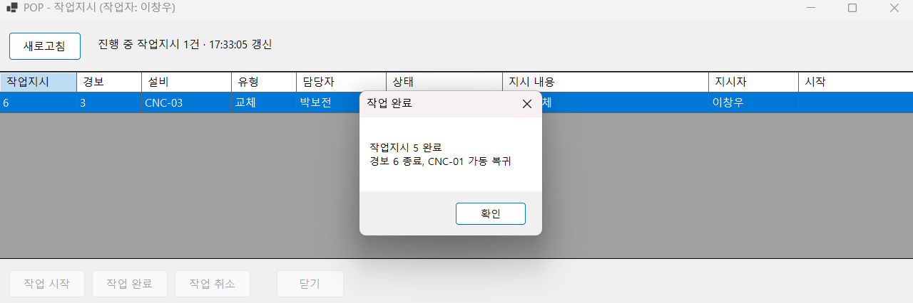

# pop-client

설비 경보와 보전 작업지시를 현장에서 처리하는 C# WinForms 단말입니다.
화면만 담당하고 업무 규칙 검사는 [mes-api](../mes-api)에서 합니다.



## 개요

| 항목 | 내용 |
|---|---|
| 기능 | 경보 확인, 오경보 종료, 작업지시 생성/시작/완료/취소 |
| 기술 | .NET 10 Windows Forms, HttpClient, System.Text.Json |
| 연동 | mes-api REST API 8개 |

## 처리 흐름

1. 메인 화면에 아직 처리되지 않은 경보가 뜹니다 (OPEN은 빨강, ACK는 노랑, 10초마다 갱신)
2. 경보를 확인(ACK)한 뒤 오경보로 닫거나 작업지시를 만듭니다
3. 작업지시 화면에서 작업을 시작하면 설비가 정비 중으로 바뀝니다
4. 작업을 완료하면 경보가 닫히고 설비가 다시 가동 상태로 돌아갑니다

## 화면

### 작업지시 생성



작업 유형은 목록에서만 고를 수 있게 해서 잘못된 값이 서버로 가지 않게 했습니다.

### 서버에서 거부된 경우



같은 경보에 진행 중인 작업지시가 이미 있으면 서버가 409로 막습니다. 단말은 서버가 보낸 사유를 그대로 보여줍니다.

### 작업지시 목록



대기 중인 작업은 노랑으로 표시하고 진행 중인 작업은 파랑으로 표시합니다. 선택한 작업의 상태에 맞는 버튼만 켜집니다.

### 작업 완료





결과 코드와 조치 내용을 모두 입력해야 완료할 수 있습니다. 경보 종료와 설비 상태 변경은 서버가 한 번에 처리합니다.

## 버튼과 상태

| 화면 | 버튼 | 누를 수 있는 상태 | 결과 |
|---|---|---|---|
| 경보 | 확인 (ACK) | OPEN | 담당 확인 기록 |
| | 오경보 종료 | ACK | 메모를 남기고 경보 종료 |
| | 작업지시 생성 | ACK | 작업지시 대기 상태로 생성 |
| 작업지시 | 작업 시작 | WAITING | 설비 정비 중으로 변경 |
| | 작업 완료 | IN_PROGRESS | 경보 종료 후 설비 가동 복귀 |
| | 작업 취소 | WAITING | 경보는 확인 상태로 남음 |

작업자 이름을 입력해야 처리할 수 있고 이 이름이 서버에 처리자로 기록됩니다.

## 구현하면서 신경 쓴 부분

### 버튼은 화면에서 막고 규칙은 서버에서 막기

화면에 보이는 상태는 최대 10초 전 정보입니다. 그 사이 다른 단말에서 먼저 처리했을 수 있어서 버튼을 끄는 것만으로는 부족합니다.
최종 판단은 서버의 조건부 UPDATE가 하고 단말은 그 결과를 보여주기만 합니다.

### 에러 처리를 한 곳으로 모으기

mes-api는 모든 에러를 `{code, message}` 형태로 보냅니다. `ApiClient`가 이 응답과 연결 실패를 `ApiException`으로 바꾸고 화면은 이 예외 하나만 처리합니다.

자동 갱신이 실패했을 때는 팝업 없이 상단 글자로만 알립니다. 서버가 잠깐 꺼졌을 때 10초마다 팝업이 쌓이는 걸 막기 위해서입니다.

### 응답을 기다리는 동안 화면이 멈추지 않게

서버 호출은 모두 async/await로 처리했습니다. 처리 중에는 버튼을 잠가서 같은 요청이 두 번 가지 않게 했고 새로고침 후에도 선택한 줄이 그대로 유지됩니다.

## 폴더 구조

```
PopClient
├── Api
│   ├── ApiClient.cs        mes-api 호출과 응답 변환
│   └── ApiException.cs     서버 거부와 연결 실패를 담는 예외
├── Models                  서버 JSON과 같은 모양의 record
├── MainForm                경보 목록 화면
├── WorkOrderForm.cs        작업지시 목록 화면
├── WorkOrderDialog.cs      작업지시 입력 창
├── CompleteDialog.cs       작업 완료 입력 창
└── MemoDialog.cs           메모 입력 창 (오경보 종료와 작업 취소에서 사용)
```

## 실행

1. mes-api를 먼저 실행합니다 (`http://localhost:8080`)
2. Visual Studio에서 `PopClient/PopClient.slnx`를 엽니다 (.NET 데스크톱 개발 워크로드 필요)
3. F5로 실행합니다

서버 주소는 `MainForm.cs`의 `new ApiClient("http://localhost:8080/")`에서 바꿀 수 있습니다.

## 한계

- 로그인이 없어서 작업자 이름을 직접 입력합니다
- 새 경보는 10초 간격 조회로 받습니다. 바로 알림을 받으려면 SignalR 같은 서버 푸시가 필요합니다
- 서버 주소가 코드에 들어가 있습니다. 여러 단말에 배포하려면 설정 파일로 빼야 합니다
