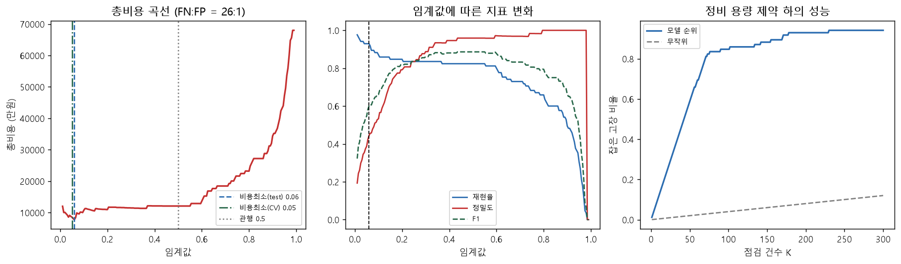
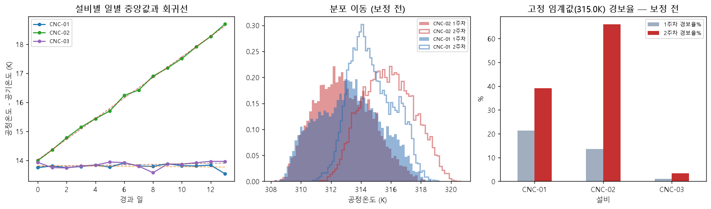
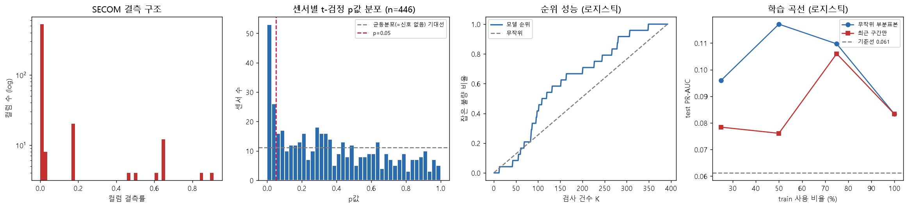

# 설비 예지보전 분석 리포트

> 작성일: 2026-10-22 · 작성자: 이창우 (GitHub: apxkzmfh789)
> 코드: https://github.com/apxkzmfh789/Predictive-Maintenance
> 대시보드: https://predictive-maintenance-apxkzmfh789.streamlit.app
> 숫자 근거: 저장소의 `outputs/*.txt` (`python run_all.py` 실행 결과)

---

## 1. 한 줄 결론

**CNC 설비의 30분 내 고장을 시간순 split 기준 PR-AUC 약 0.76(기준선 대비 3배 이상)으로 예측할 수 있으나,
같은 데이터·같은 모델을 랜덤 split으로 평가하면 0.98까지 부풀려집니다(22.7% 과대평가).
성능 자체보다 이 차이를 확인하고 평가 방식에서 막은 것이 이 프로젝트의 결론입니다.**

---

## 2. 핵심 숫자

| 지표 | 값 | 비고 |
|---|---|---|
| 분석 대상 | 55,591행 → 학습 53,811행 | 3대 × 14일 × 1분 (2024년 기준 기간) |
| 예측 목표 | 향후 30분 내 고장 여부 | test 양성률 23.8% |
| **PR-AUC (시간순 split)** | **0.761** | 기준선 0.238 대비 3.2배 |
| PR-AUC 랜덤 vs 시간순 | 0.982 vs 0.759 | 같은 데이터에서 split만 변경, 4.2 참조 |
| 적용 임계값 | 0.045 | 0.5가 아니라 비용 최소점 |
| 재현율 / 정밀도 | 0.972 / 0.370 | 임계값 0.045 기준 |
| AI4I 실데이터 PR-AUC | 0.897 | 기준선 0.034 대비 26배 |
| AI4I 임계값 (교차검증) | 0.05 | 관행 0.5 대비 비용 29.3% 절감, 낙관 편향 780만원 확인 |
| SECOM 실데이터 PR-AUC | 0.083 | 기준선 0.061 대비 1.36배, **실패** |
| 수집 데이터 손실 | 결측률 0.81% vs 실제 손실 8.08% | 결측률만 보면 손실을 10배 과소평가 |

> **시간순 PR-AUC가 두 개(0.761, 0.759)인 이유**: 시뮬레이터 데이터는 두 경로로 만들어집니다.
> (a) `analysis/a1_pipeline.py`가 14일치를 한 번에 생성한 것 → `a3_leakage.py` 시간순 PR-AUC 0.759
> (b) `src/collector.py`가 하루씩 14번 수집해 쌓은 것 → `src/train.py` PR-AUC 0.761
> 날짜별 시드가 달라 데이터는 다르지만 결과는 거의 같습니다.
> 서로 다른 경로로 만든 데이터에서 같은 결론이 나오는 것도 하나의 검증입니다.

---

## 3. 데이터와 방법

### 3.1 데이터

| 출처 | 규모 | 기간/기준 | 역할 |
|---|---|---|---|
| 자체 시뮬레이터 | 55,591행 (오염 후) | 2024-01-01 ~ 01-14, 1분 간격 | 파이프라인·누수 검증, 기준 모델 |
| GitHub Actions 수집 | 하루 약 3,900행 | 2026-10-22부터 매일 | 최근 14일 재학습 (3.5 참조) |
| UCI AI4I 2020 | 10,000행 × 14열 | 스냅샷 (시점 정보 없음) | 실데이터 모델링 |
| UCI SECOM | 1,567행 × 590센서 | 2008-07-19 ~ 10-17 | 고차원·불균형 사례 |

> **시뮬레이터는 합성 데이터입니다.** 물리식(절삭 전력, 열 방출, 마모 누적)으로 참값을 만들고,
> 그 위에 현장에서 실제로 발생하는 오염(통신 끊김, 센서 튐, 타임스탬프 중복·흔들림, 단위 혼재, 드리프트)을 주입했습니다.
> 참값을 알고 있으므로 **전처리가 원래 값을 얼마나 되찾았는지 검증할 수 있다는 것**이 이 구조의 목적입니다.

### 3.2 처리 이력

| 단계 | 행 수 | 증감 | 설명 |
|---|---|---|---|
| 0. 원본 수신 | 55,591 | — | 14개 일별 CSV |
| 1~2. 타입 강제·타임스탬프 스냅 | 55,591 | 0 | 초 단위 흔들림을 분 격자에 스냅 |
| 3. 중복 제거 | 53,874 | −1,717 | (machine_id, ts) 기준 |
| 4. 단위 통일 | 53,874 | 0 | 온도 K↔℃, 진동 m/s²→mm/s |
| 5. 물리범위 위반 → NaN | 53,874 | 0 | **행을 지우지 않고 값만 NaN** |
| 6. 스파이크 플래그 | 53,874 | 0 | Hampel 필터, **지우지 않고 표시만** |
| 7. 짧은 결측 보간 | 53,874 | 0 | 짧은 구간만 보간, 긴 끊김은 남김 |
| 8. 드리프트 보정 | 53,874 | 0 | CNC-02 공정온도 드리프트 보정 |
| 9. 시간축 재색인 | 60,479 | +6,605 | 통신 끊김 구간을 명시적 NaN 행으로 |

> **행 수 차이 설명**: 원본 55,591 → 중복 1,717건 제거 → 53,874.
> 재색인에서 늘어난 6,605행은 "데이터가 없다"는 사실을 드러낸 빈 행입니다.
> 학습에서는 제외하며, 피처 생성 후 최종 학습 데이터는 53,811행입니다.
>
> 타임스탬프를 분 격자에 맞춘 뒤 중복을 제거하면 실제 보유 행은 53,874행으로,
> 있어야 할 60,480행 대비 **손실은 10.9%** 입니다. 시각을 맞추기 전 원본으로 계산한 손실률 8.08%(4.7)보다 큽니다.
> 흔들린 시각 때문에 걸러지지 않던 중복이 스냅 후 드러나기 때문입니다.

### 3.3 검증 — 참값 대비 복원 정확도

| 센서 | 정제 전 MAE | 정제 후 MAE | 개선 | MAE/참값std |
|---|---|---|---|---|
| air_temp_k | 36.591 | 0.0597 | 613배 | 0.026 |
| process_temp_k | 35.587 | 0.0226 | 1,572배 | 0.011 |
| rot_speed_rpm | 149.514 | 2.8330 | 53배 | 0.006 |
| vibration_mms | 1.127 | 0.0059 | 192배 | 0.011 |

8개 센서 모두 MAE/std < 0.05(최대 0.039, 습도) → **원래 값을 사실상 되찾았습니다.**
드리프트 추정값 0.3463 K/day는 참값 0.35 K/day 대비 오차 1.1%였습니다.

### 3.4 모델링

- 피처 100개: 원시 센서 + 물리 파생(전력, 마모×토크 등) + 롤링 통계(10/30/60분 평균·표준편차) + 차분
- **롤링 피처는 과거만 참조** (`shift(1)` 후 rolling). 단, 정제 단계의 Hampel 필터는 `center=True`입니다 (5장 참조)
- 모델: RandomForest(n=300, min_samples_leaf=2, seed=42)
- **split: 시간순 75:25** (train 01-01 ~ 01-11, test 01-11 ~ 01-14)
- 임계값: 총비용 최소점 (FN 800만원 : FP 30만원 가정)
- 기준 기간은 `data/history`의 2024-01-01 ~ 01-14 파일로 고정 (`python src/train.py` 기본 실행)

### 3.5 운영 구조 — 자동 수집과 두 기간 분리

| 구분 | 데이터 | 결과 위치 | 갱신 |
|---|---|---|---|
| 2024년 기준 | 2024-01-01 ~ 01-14 고정 | `models/` | 고정 (재현용, 이 리포트의 숫자) |
| 최근 14일 | 마지막 시각 기준 14일 | `models/recent/` | GitHub Actions가 매일 갱신 |

- GitHub Actions가 매일 06:17(KST)에 최근 24시간 데이터를 수집 → `train.py --recent 14`로 재학습 → 자동 커밋합니다
- 스케줄은 정시를 보장하지 않으므로 "특정 시각"이 아니라 "최근 24시간 구간"을 가져오고, (machine_id, ts) UNIQUE로 중복 실행에도 안전하게 했습니다
- 2024년 데이터와 실시간 수집 데이터 사이에는 2년 이상의 공백이 있습니다. 이 공백이 재색인·드리프트 보정·손실률 계산에 섞이지 않도록 **학습(`train.py`), 품질 분석(`a8`), 대시보드가 모두 같은 기간 기준**을 씁니다
- 대시보드는 상단에서 기간을 선택하면 모든 탭이 해당 기간 데이터와 결과로 바뀌고, 모델 성능 탭에서 두 기간 성능을 비교합니다
- Streamlit Cloud 메모리 제한(1GB) 때문에 앱은 학습하지 않고 결과 파일만 읽습니다. 버전 불일치 위험이 있어 모델(.pkl) 대신 예측 결과와 지표를 저장합니다

---

## 4. 주요 발견

### 4.1 정확도는 이 문제에서 무의미합니다

AI4I 고장률 3.39%. "전부 정상"이라 답하는 모델의 정확도는 **0.9660**, 재현율은 **0.0000**입니다.

| 모델 | 정확도 | 재현율 | PR-AUC |
|---|---|---|---|
| 무조건 정상 | 0.9660 | 0.0000 | 0.0340 |
| 로지스틱 | 0.9676 | 0.1412 | 0.4051 |
| 랜덤포레스트 | 0.9824 | 0.5765 | 0.7889 |
| 랜덤포레스트 + 파생변수 | 0.9928 | 0.8235 | 0.8966 |

정확도는 0.966~0.993 사이에 몰려 있어 모델을 구분하지 못합니다.
**PR-AUC 기준선은 고장률 그 자체(0.034)** 이며, 이 대비 몇 배인지를 봐야 합니다.
파생변수(온도차, 전력, 마모×토크)는 AI4I 고장 정의식을 변수로 옮긴 것으로, 모델 변경 없이 PR-AUC를 0.789 → 0.897로 올렸습니다.

### 4.2 시간 누수 — 이 리포트의 핵심

같은 데이터·같은 모델·같은 하이퍼파라미터, **split만** 변경:

| split | ROC-AUC | PR-AUC | F1@0.5 |
|---|---|---|---|
| 랜덤 split | 0.9954 | 0.9819 | 0.9358 |
| 시간순 split | 0.8956 | 0.7589 | 0.6771 |
| **차이** | −10.0% | **−22.7%** | −27.6% |

**메커니즘을 확인했습니다.** test 행에서 가장 가까운 train 행까지의 시간 거리:

- 랜덤 split: **중앙값 0분** (최대 2분)
- 시간순 split: 중앙값 2,449분

예측 라벨은 "향후 30분 내 고장"이라 인접 행끼리 라벨 창이 29/30 겹칩니다(라벨 lag-1 자기상관 0.976).
랜덤 split은 이 쌍을 train/test로 갈라, 사실상 정답을 미리 보여줍니다.

**단서 조항 두 가지:**

1. **문제 정의를 '감지'로 바꾸면 누수가 사라집니다.**
   목표를 "지금 고장인가"로 두면 랜덤 0.9597 vs 시간순 0.9662로 차이가 없습니다.
   현재 센서값만으로 결정되는 규칙이라 인접 행의 정답에 미래 정보가 없기 때문입니다.
2. **AI4I에서는 랜덤 split이 안전합니다.** lag-1 자기상관이 0.005로,
   연속 로그가 아니라 독립 스냅샷이기 때문입니다.

> 따라서 정확한 원칙은 "시계열이면 시간순 split"이 아니라
> **"행 간 시간적 의존성이 있거나 라벨 창이 겹치면 시간순 split"** 입니다.

train과 test 사이에 30~180분 간격을 두어도 PR-AUC는 0.762~0.766으로 거의 같았습니다.
시간순 split에서 경계의 라벨 창 겹침이 결과에 주는 영향은 작습니다.

### 4.3 이상치를 지우면 고장이 사라집니다

AI4I에서 IQR(1.5) 기준 이상치를 제거한 뒤 학습:

| 처리 | train 고장 수 | 재현율 | PR-AUC |
|---|---|---|---|
| 아무것도 안 지움 | 254 | 0.8235 | 0.8966 |
| IQR 이상치 행 삭제 | 197 | **0.7412** | 0.8193 |
| 지우지 않고 플래그로 추가 | 254 | 0.8000 | 0.8852 |

토크 IQR 이상치 69건 중 **89.9%가 실제 고장**이었습니다.
PWF(전력 이상) 고장의 68.4%가 삭제 대상에 들어갔습니다.

> **단, 이 규칙은 데이터에 따라 정반대로 작동합니다.**
> 시뮬레이터에서는 8~40배로 튀는 센서 오작동이 사분위수를 밀어올려
> IQR 경계가 바깥으로 이동하고, 진짜 고장은 경계 **안쪽**에 남았습니다
> (IQR 이상치 579건 중 진짜 고장은 6건).
> → **이상치 규칙은 적용 전에 "무엇이 걸리는지" 확인해야 합니다.**

**오작동과 진짜 이상을 구분하는 방법**: 센서 하나만 보면 구분할 수 없고, 여러 센서의 물리적 정합성을 봐야 합니다.

| 판정 규칙 | 걸린 행 | 센서오작동 비중 |
|---|---|---|
| Hampel 단독 | 865 | 24.2% |
| 토크·전류 동시 이상 | 103 | **1.9%** |

토크만 튀고 전류가 그대로면 물리적으로 불가능하므로 센서 문제로 판단합니다.

### 4.4 임계값은 비용이 정합니다

| 임계값 | 재현율 | 정밀도 | 총비용 |
|---|---|---|---|
| 0.435 (F1 최대) | 0.824 | 0.959 | 12,090만원 |
| 0.50 (관행) | 0.824 | 0.959 | 12,090만원 |
| 0.06 (test에서 고른 비용 최소) | 0.929 | 0.444 | 7,770만원 |
| **0.05 (교차검증으로 고른 비용 최소)** | 0.929 | 0.387 | **8,550만원** |

F1 최대점과 비용 최소점은 일치하지 않습니다. F1은 비용 비대칭을 반영하지 못합니다.

**test 재사용 문제를 교차검증으로 확인했습니다.**
test에서 임계값을 고르고 같은 test로 비용을 재면(7,770만원, 35.7% 절감) test 정보를 미리 본 낙관적 추정이 됩니다.
train 안에서 교차검증(out-of-fold 예측)으로 임계값을 고른 뒤 처음 보는 test에 적용하면 8,550만원으로,
**낙관 편향은 780만원**이었습니다. 관행 0.5 대비 절감률은 **29.3%** 가 운영 기대치에 더 가깝습니다.

비용비 민감도:

| FN:FP 비용비 | 최적 임계값 | 재현율 |
|---|---|---|
| 1:1 | 0.435 | 0.824 |
| 10:1 | 0.340 | 0.835 |
| 26:1 (본 분석 가정) | 0.060 | 0.929 |
| 100:1 | 0.010 | 0.976 |

**정비 용량 관점으로 바꾸면**: 상위 100건만 점검하면 test 고장 85건 중 **72건(85%)** 을 잡습니다.
무작위로 100건을 고르면 기대 탐지는 3.4건입니다.

> 시뮬레이터 모델(`train.py`)에서도 임계값 0.045가 0.5 대비 총비용을 74.5% 줄였습니다.
> 다만 이 비용은 1분 단위 행마다 계산한 값이라(고장 1건 직전 30분이 각각 계산됨) 절대 금액보다 감소율로 해석해야 합니다.

### 4.5 센서 드리프트 — 모델보다 룰이 먼저 깨집니다

CNC-02 공정온도 센서에 0.35 K/day 드리프트가 있었습니다(14일간 4.9 K).
일별 집계 + 회귀 기울기 검정으로 탐지했고(기울기 0.355, t=92), 라인 중앙값 대비 잔차로 0.3463 K/day를 추정했습니다.

**모델 성능에는 거의 영향이 없었습니다.** 보정 후 PR-AUC가 오히려 소폭 낮았습니다
(CNC-02 단독 0.7515 → 0.7253). 트리 모델이 단조 편향을 다른 피처와 조합해 흡수하고, 보정은 추정 오차만큼 잡음을 더하기 때문입니다.

**진짜 영향은 고정 임계값 경보였습니다** (공정온도 315 K 초과 경보).

| 설비 | 1주차 경보율 | 2주차 경보율 |
|---|---|---|
| CNC-01 | 21.26% | 39.18% |
| **CNC-02 (보정 전)** | 13.63% | **65.97%** |
| CNC-02 (보정 후) | 1.57% | 6.66% |

설비는 정상인데 센서가 밀려서 나는 가짜 경보입니다.
현장에서 이런 일이 반복되면 작업자가 경보를 무시하게 되고, 그다음 진짜 고장을 놓칩니다.

**CNC-01 경보율 상승은 드리프트가 아닙니다.**
CNC-01도 경보율이 21% → 39%로 올랐지만, (공정온도 − 공기온도) 일별 중앙값은 13.5~13.9 K로 일정했고 기울기도 유의하지 않았습니다(p=0.57).
공기(실내) 온도가 올라 공정온도가 함께 오른 것이므로 센서 문제가 아니라 환경 변화입니다.
같은 "경보율 상승"이라도 원인이 다르면 대응(센서 교정 vs 공조 확인)이 달라집니다.

### 4.6 SECOM — 예측에 실패했습니다

| 모델 | 정확도 | 재현율 | PR-AUC |
|---|---|---|---|
| 무조건 정상 | 0.9388 | 0.0000 | 0.0612 |
| 로지스틱 | 0.9209 | 0.0000 | **0.0833** |
| 랜덤포레스트 | 0.9388 | 0.0000 | 0.0716 |

기준선 0.0612 대비 1.36배입니다.
PR-AUC 1등 모델(로지스틱)로 상위 K 검사 전략을 확인해도 상위 50건 향상도 0.65배, 상위 100건 1.63배로 무작위 검사와 뚜렷한 차이가 없었습니다.

**원인 분석:**

1. **신호가 약합니다.** p값 상위 20개 센서의 Cohen's d 중앙값 0.32(작은 효과)
2. **고차원 저표본.** 불량 104건 vs 센서 590개
3. **공정이 시간에 따라 변합니다.** 상위 50개 센서 중 **92%** 에서 전/후반 분포가 유의하게 다름
   (전반부 불량률 8.56% → 후반부 4.72%)

**학습 곡선으로 "표본 부족" 가설을 검증했습니다.**

| train 사용 비율 | 25% | 50% | 75% | 100% |
|---|---|---|---|---|
| 무작위 부분표본 PR-AUC | 0.096 | 0.117 | 0.110 | 0.083 |
| 최근 구간만 PR-AUC | 0.078 | 0.076 | 0.106 | 0.083 |

데이터를 4배로 늘려도 PR-AUC가 오르지 않았고, 모든 값이 기준선(0.061) 근처에 머물렀습니다.
최근 데이터만 쓴다고 나아지지도 않았습니다. 따라서 **표본 부족보다 센서에 담긴 신호가 약한 것이 주원인**일 가능성이 큽니다.

**다중검정 함정도 확인했습니다.** 446개 센서를 t-검정하면 p<0.05가 79개 나오지만,
우연히 기대되는 개수가 22.3개입니다. Bonferroni 통과는 **6개**, BH(FDR 5%)는 **22개**뿐입니다.
### 4.7 결측률은 손실을 숨깁니다

수집 원본 기준 컬럼 결측률은 평균 **0.81%** 로 "깨끗해 보이지만", 있어야 할 행(14일 × 1,440분 × 3대 = 60,480행) 대비 실제 보유 행은 55,591행으로 **손실률 8.08%** 입니다.
`isna()`는 들어온 행 안의 빈칸만 세기 때문에, 통신이 끊겨 통째로 안 들어온 행은 보이지 않습니다.

| 지표 | 값 |
|---|---|
| 2분 넘는 수집 공백 | 284회 (설비별 93~97회) |
| 최장 공백 | 47분 |
| 총 결손 시간 | 87.1시간 |
| 공기온도 단위 혼재(섭씨 기록) | 8.98% |

세 설비의 공백 횟수와 결손 시간이 비슷해, 설비가 아니라 수집(통신) 쪽 문제로 판단합니다.
대시보드 "데이터 품질" 탭이 이 숫자를 그대로 보여줍니다.

---

## 5. 한계와 가정

**데이터의 한계**

- 시뮬레이터 데이터는 **합성**입니다. 성능 수치를 실제 설비에 적용할 수 없습니다.
  이 프로젝트가 검증한 것은 성능이 아니라 **파이프라인과 평가 방법**입니다.
- 시뮬레이터의 고장 규칙은 **결정론적**입니다(전력 범위, 마모×토크 임계 등).
  실제 설비 고장은 확률적이며 예측이 훨씬 어렵습니다. 성능이 낙관적으로 나옵니다.
- 14일 × 3대입니다. **계절성, 장기 열화, 설비 개체차**를 반영하지 못합니다.
- AI4I는 **시점 정보가 없는 스냅샷**이라 진정한 시계열 검증이 불가능합니다.
  UDI 순서를 시간 대용으로 썼으나, 실제 수집 순서라는 보장이 없습니다.
- AI4I **라벨에 모순이 있습니다.** RNF 19건 중 18건이 `Machine failure=0`이고,
  `Machine failure=1`인데 세부 모드가 없는 행이 9건입니다.
  원본 정의를 그대로 사용했으며, RNF 재현율은 0.000입니다(센서 신호가 없는 무작위 고장).
- 대시보드와 a8의 손실률 8.08%는 흔들린 타임스탬프를 분 격자에 맞추기 전 값입니다.
  정제 기준 실제 손실은 10.9%로 더 큽니다(3.2 참조). 앱 표시용 숫자와 실제 손실을 구분해야 합니다.

**방법의 한계**

- **비용 가정(800만원 : 30만원)은 추정치**입니다. 실제 값은 정비팀에서 받아야 합니다.
  민감도 분석은 했으나, 가정이 틀리면 임계값 결론이 바뀝니다.
- **임계값 선택의 낙관 편향**: AI4I에서는 교차검증으로 편향 크기(780만원)를 확인했습니다.
  시뮬레이터 모델(`train.py`)은 아직 test에서 임계값을 고르고 있어 같은 낙관 편향이 남아 있습니다.
- **"30분 내 고장" 라벨은 실제로는 "다음 30행"입니다.**
  통신이 끊긴 빈 행을 지운 뒤 행 단위로 라벨과 롤링 피처를 만들어, 공백을 사이에 두면 30분보다 긴 구간이 한 창에 묶입니다.
- **`train.py`의 시간순 split 경계에 간격(purging)이 없습니다.**
  train 마지막 행의 라벨(다음 30분)이 test 구간을 봅니다. 4.2의 간격 실험상 영향은 작지만 원칙적으로는 약한 누수입니다.
- **정제 단계에 약한 전처리 누수가 있습니다.**
  Hampel 필터가 `center=True`(앞뒤 창 사용)이고 결측 보간도 양방향이라, 정제 시점에 미래 값이 조금 반영됩니다.
  피처 롤링은 과거만 보지만 정제 단계는 그렇지 않습니다.
- **온도가 0으로 튄 값은 단위 보정에서 놓칩니다.**
  0은 섭씨로 판정돼 273.15 K로 변환되고, 물리범위 안이라 범위검사를 통과합니다(공기온도 스파이크 범위검사 재현율 0.477).
- 시간순 split을 1회만 수행했습니다. **시계열 교차검증**(walk-forward)을 쓰면
  성능 추정의 불확실성을 구간으로 제시할 수 있으나, 이번에는 적용하지 않았습니다.
- 드리프트 보정 효과의 차이(−3.5%)는 작아서 **잡음과 구분되지 않습니다.**
  seed를 바꾸면 부호가 뒤집힐 수 있는 크기라 "보정이 해롭다"고 단정하지 않습니다.
- 롤링 피처가 100개인데 변수 선택을 하지 않았습니다.

**해석의 한계**

- **상관은 인과가 아닙니다.** "토크가 높으면 고장난다"는 관계이지
  "토크를 낮추면 고장이 준다"는 보장이 아닙니다.
- 변수 중요도는 **모델이 무엇을 썼는지**를 말할 뿐, **물리적 원인**을 말하지 않습니다.
  상관된 변수끼리 중요도가 임의로 나뉩니다.
- SECOM test 불량은 24건뿐이라 불량 1건 차이로 PR-AUC와 향상도가 크게 흔들립니다.
  학습 곡선의 0.01~0.03 차이는 잡음일 수 있습니다.
- SECOM 결과는 "이 데이터로는 안 된다"이지 "반도체 불량 예측은 불가능하다"가 아닙니다.